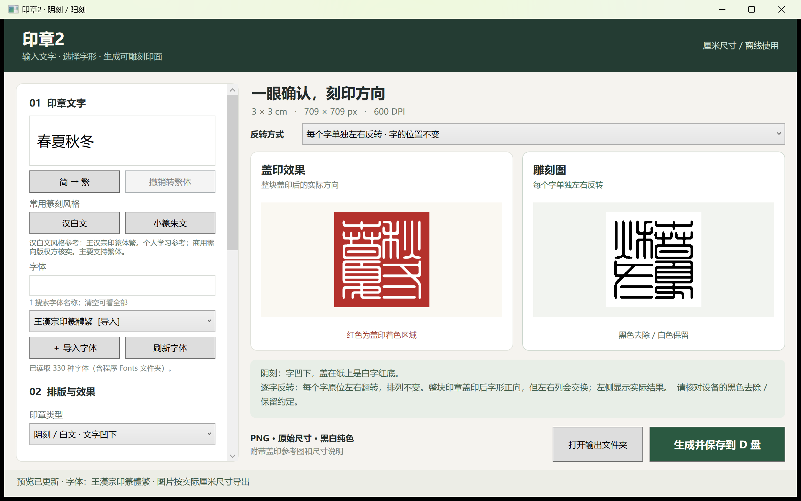
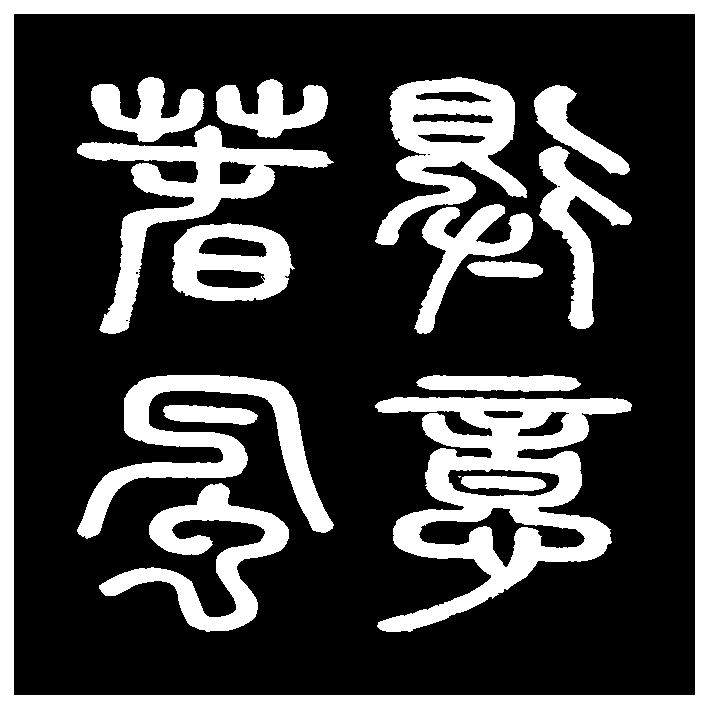

# 印章2 · Seal Studio 2

一款用于**中文篆刻印章排版与雕刻图生成**的 Windows 桌面工具。输入文字、选择字体与章法，即可导出带真实厘米尺寸和 DPI 信息的纯黑白雕刻图，适用于激光雕刻、CNC 雕刻等后续加工流程。

> A Windows desktop app for laying out Chinese seals and exporting engraving-ready black-and-white bitmaps. Built with C# / WPF / .NET Framework.




## 功能特性

- **传统章法排版**：竖排右起自动分列、横排左起自动换行、按输入换行、每行一列，共四种排字方式；支持 1～12 列、字大小、字间留白、内边距与边框调整。
- **阳刻 / 阴刻**：一键切换朱文（文字凸起）与白文（文字凹下），预览与实际盖印效果同步显示。
- **四种反转方式**：整章左右反转、逐字单独反转、指定字反转、不反转。雕刻图与“盖印效果”分开呈现，避免雕刻软件二次镜像。
- **真实物理尺寸**：宽高以厘米设置（0.3～20 cm），DPI 150～1200，自动换算像素并写入 PNG DPI 元数据；内置 1600 万像素 / 单边 8000 像素保护。
- **字体管理**：自动读取系统字体与程序 `Fonts` 文件夹；支持导入 TTF / OTF / TTC，无需安装到 Windows；缺字检测会阻止导出，避免自动回退字体造成错字。
- **简 → 繁转换**：内置一键转换与撤销，方便使用主要支持繁体字形的篆刻字库。
- **雕刻参数**：可选“黑色 = 雕刻去除区域”或“黑色 = 保留凸起区域”，与水平镜像相互独立。
- **完整导出包**：每次生成独立文件夹，包含雕刻图 PNG（可选 BMP）、盖印效果参考图 PNG、`尺寸与使用说明.txt`，不覆盖旧作品。
- **离线可用**：单文件程序，无需安装，不联网；自动记住上次参数到 `设置.xml`。

## 效果示例

| 阳刻 · 盖印效果 | 阴刻 · 盖印效果 |
| :---: | :---: |
|  |  |
|  |  |

## 下载与使用

1. 打开 [Releases](../../releases) 页面，下载最新的 `SealStudio-2-v1.0.0-win64.zip`。
2. 解压到任意目录（建议路径不含特殊符号），双击 `印章2.exe` 启动。
3. 输入文字 → 选择字体/风格 → 设置章法与尺寸 → 选择反转方式 → 生成并保存。

详细操作见 [使用说明](docs/USAGE.zh-CN.md)。

> 运行环境：Windows 10 / 11 64 位，系统自带 .NET Framework 4.8。

## 从源码构建

需要 Visual Studio 2022（“.NET 桌面开发”工作负载）或 Visual Studio Build Tools，包含 .NET Framework 4.8 目标包。

```powershell
# 在仓库根目录执行
msbuild .\src\印章2.csproj /p:Configuration=Release /p:Platform=x64
```

生成文件位于 `src\bin\印章2.exe`。也可以使用仓库自带脚本自动查找 MSBuild：

```powershell
.\scripts\build.ps1
```

> 源码默认目标框架为 .NET Framework 4.8。如需兼容更老的系统，可将 `印章2.csproj` 中的 `TargetFrameworkVersion` 改为 `v4.0` 并安装 .NET Framework 4.0 Developer Pack。

## 自检与测试

程序内置命令行自检，覆盖尺寸换算、镜像像素一致性、阴阳刻互补、四种排版、DPI 元数据、缺字拦截、设置迁移等 24 项检查：

```powershell
.\src\bin\印章2.exe --selftest .\test-output
Get-Content .\test-output\test-report.txt
```

## 字体说明

本仓库**不包含第三方字体文件**，以避免字体授权不清导致的再分发问题。程序可直接使用系统自带字体（楷体、隶书、宋体等）；如需篆刻风格字库，请从官方渠道获取后通过“＋ 导入字体”导入：

- **崇羲篆體 / Chong Xi Small Seal** — 王心怡、季旭昇等，Academia Sinica。官方发布：<https://xiaoxue.iis.sinica.edu.tw/chongxi/>。许可：CC-BY-ND-3.0-TW-or-later（可复制传播及商业利用，需署名，不得修改字体）。
- **王漢宗印篆體繁 / HanWangInJang** — 王汉宗。来源与授权情况请见 [字体说明](docs/FONTS.md)；商用前请向版权方核实。

字库版权归原作者所有，字体文件不适用本仓库的 MIT 许可证。详见 [docs/FONTS.md](docs/FONTS.md)。

## 项目结构

```text
src/
  SealApp.cs        WPF 界面、字体管理、设置读写
  SealCore.cs       排版、字形栅格化、镜像、导出核心
  MainWindow.xaml   界面布局
  SelfTest.cs       命令行自检入口
  MirrorTests.cs    镜像与布局回归测试
docs/
  USAGE.zh-CN.md    完整使用说明
  FONTS.md          字体来源与授权说明
  images/           界面与效果示例
scripts/
  build.ps1         一键构建脚本
```

## 已知限制

- 仅生成位图图片，不生成刀路、激光功率或雕刻深度。
- 部分特殊编码的篆字库未映射到常规汉字，无法通过普通汉字输入直接使用。
- 不同电脑可用字体数量不同；导出前请核对缺字提示。
- 雕刻软件若忽略 PNG DPI，需要导入后手动设置实际厘米尺寸。

## 许可证

源代码采用 [MIT License](LICENSE) 发布。第三方字体、字体名称与示例中涉及的字体版权归各自作者所有，不适用 MIT 许可证。

## 致谢

- 崇羲篆體作者：王心怡、季旭昇；指导：谢清俊；参与：庄德明；Academia Sinica 发布。
- 王漢宗印篆體作者：王汉宗。
- 感谢所有为本项目提供测试反馈与建议的用户。
